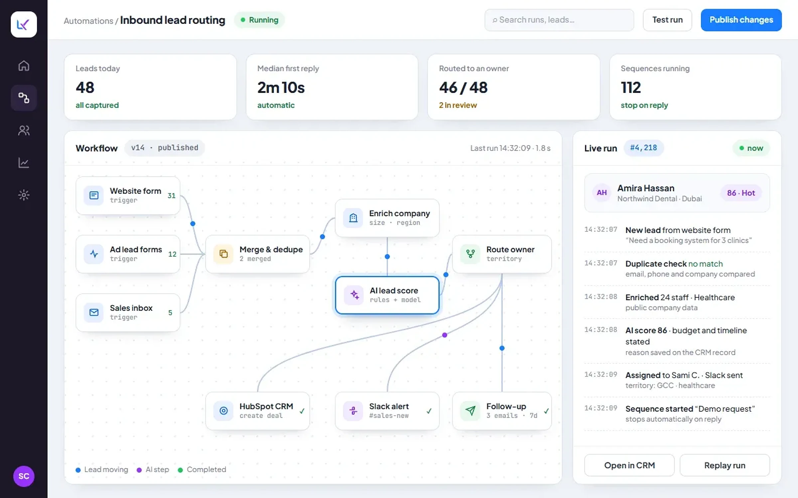

# Lead Capture & CRM Automation

> **Solution blueprint.** A reference architecture Lexvaxa designed for this problem, not a delivered client project.

**Every enquiry captured, enriched, scored and routed to the right person, with follow-ups that send themselves.**

      

## Overview

A solution blueprint for sales teams that lose leads between forms, inboxes and spreadsheets. New enquiries from the website, ads and email flow into one pipeline, are enriched and scored, land in the CRM with the right owner, and trigger timed follow-ups until someone replies.

## The challenge

Leads arrive from many places, are copied into the CRM by hand and too often wait hours, or forever, for a first reply.

## The solution

An automated pipeline that captures each lead once, removes duplicates, scores it with clear rules and AI notes, assigns an owner and starts the follow-up sequence immediately.

## Key features

- Capture from forms, ads and email, without duplicates
- Lead scoring with AI notes and owner routing
- Timed follow-ups that stop on reply

## Tech stack

n8n · Node.js · HubSpot API · OpenAI API · PostgreSQL

## Privacy

This blueprint uses illustrative data only.

## Links

- Case study on Lexvaxa: https://lexvaxa.com/work/lead-crm-automation
- Built by **Ch Muhammad Samiullah** ([GitHub](https://github.com/samiullah156-creator)) at [Lexvaxa](https://lexvaxa.com)
